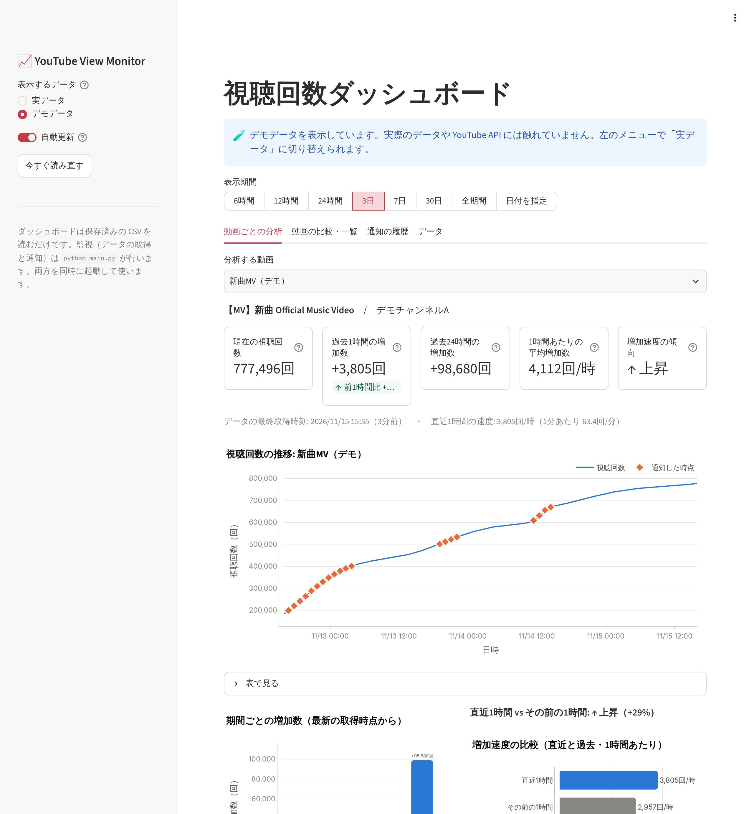
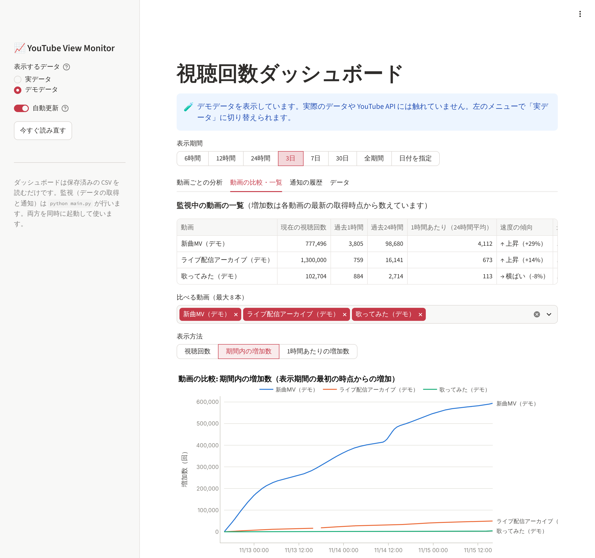

# YouTube View Monitor

YouTube の公開動画（他の人のチャンネルの動画を含む）の**視聴回数を 5 分ごとに記録**し、
**急に伸びたときに Windows の通知で知らせる**ツールです。
記録した履歴は、ブラウザで開く**ダッシュボード**でグラフにして分析できます。

推しのチャンネルの新曲 MV やライブのアーカイブが「いま、どのくらいの勢いで伸びているか」を見守る用途を想定しています。



## できること

| | |
|---|---|
| **監視**（`python main.py`） | 5 分ごとに視聴回数を取得して `data/history.csv` に保存する。最大 50 本を 1 回の API 呼び出しでまとめて取得する |
| **通知** | 「直近 60 分で 1,000 回以上増えた」などの条件で Windows の通知を出す。通知をクリックすると動画が開く。条件は動画ごとに変えられる |
| **節目の通知**（任意） | 「10 万回ごと」などの節目を超えたときにも通知する |
| **目標達成で MV を再生**（任意） | 「100 万回」などの目標再生数に到達したら、通知してブラウザで MV を再生する |
| **ダッシュボード**（`streamlit run dashboard.py`） | 視聴回数の推移、過去 1・3・6・12・24 時間の増加数、時間帯ごとの増加数、1 時間あたりの増加数の推移、直近と過去の増加速度の比較、複数動画の比較 |
| **安全・安定** | 通信エラーやクォータ超過では止まらない。二重起動を防ぐ。再起動しても履歴と通知のクールダウンを引き継ぐ。API キーはログに出さない |

監視とダッシュボードは**別々に起動します**。ダッシュボードは保存済みの CSV を読むだけなので、
何回開いても YouTube API は使わず、監視が二重に動くこともありません。

---

## 1. はじめての準備（Windows）

### 1-1. Python をインストールする

1. <https://www.python.org/downloads/> から Python 3.10 以降（3.12 か 3.13 がおすすめ）をダウンロードします。
2. インストーラーの最初の画面で **「Add python.exe to PATH」にチェック**を入れてから「Install Now」を押します。

### 1-2. このフォルダーを用意する

GitHub のページの「Code」→「Download ZIP」でダウンロードして展開するか、`git clone` します。
以下、このフォルダーを `YouTubeMonitor` と呼びます。

> OneDrive の中（「ドキュメント」「デスクトップ」など）に置くと、同期中にファイルが一時的に開けなくなることがあります。
> `C:\Users\あなたの名前\YouTubeMonitor` のような OneDrive の外がおすすめです。

### 1-3. 必要なパッケージを入れる

**`setup.bat` をダブルクリック**します。`.venv` フォルダー（このツール専用の Python 環境）が作られ、
必要なパッケージが入り、`config.json` が作られます。

<details>
<summary>コマンドで行う場合</summary>

コマンドプロンプトで `YouTubeMonitor` フォルダーに移動して実行します。

```bat
py -m venv .venv
.venv\Scripts\activate
pip install -r requirements.txt
```

PowerShell で `activate` がエラーになる場合は、先に次を 1 回だけ実行してください。

```powershell
Set-ExecutionPolicy -Scope CurrentUser RemoteSigned
```

PowerShell では `.venv\Scripts\Activate.ps1` で有効にします。
</details>

### 1-4. YouTube Data API v3 の API キーを取得する（無料）

1. <https://console.cloud.google.com/> に Google アカウントでログインします。
2. 画面上部のプロジェクト選択 →「新しいプロジェクト」→ 名前（例: `youtube-view-monitor`）を入れて「作成」。
3. 左のメニュー「API とサービス」→「ライブラリ」→ **YouTube Data API v3** を検索して「有効にする」。
4. 「API とサービス」→「認証情報」→「認証情報を作成」→「API キー」。
5. 作成されたキーの「キーを制限」（または編集）で、
   - **API の制限**: 「キーを制限」→ YouTube Data API v3 だけにチェック
   - **アプリケーションの制限**: 「なし」（家庭の回線は IP アドレスが変わるため、IP 制限はおすすめしません）
6. `AIza` で始まるキーをコピーします。

無料枠は 1 日 10,000 ユニットです。このツールは 5 分ごとに 1 ユニット（50 本まで）しか使わないので、1 日約 288 ユニットで収まります。
請求先アカウント（クレジットカード）の登録は不要です。

### 1-5. `config.json` を書き換える

`config.json` をメモ帳で開き、少なくとも次の 2 か所を書き換えます（全項目は「[4. 設定項目](#4-設定項目configjson)」）。

```json
{
  "api_key": "AIza で始まる API キーをここに貼り付け",
  "videos": [
    {"url": "https://www.youtube.com/watch?v=動画ID", "name": "推しの新曲MV"},
    {"url": "https://youtu.be/動画ID", "name": "ライブのアーカイブ", "threshold": 500}
  ]
}
```

- `url` は、動画のページの URL をそのまま貼り付けて構いません（`watch?v=`、`youtu.be/`、`shorts/`、`live/` のどれでも可。動画 ID だけでも可）。
- `name` はダッシュボードと通知に出す表示名です（省略すると YouTube のタイトルを使います）。
- 限定公開の動画も URL が分かれば監視できます。非公開・削除された動画は取得できません。

> **API キーを他人に見せたり、GitHub にアップロードしたりしないでください。**
> `config.json` は `.gitignore` に入っているので、通常の `git add` ではコミットされません。
> ファイルに書く代わりに、環境変数 `YOUTUBE_API_KEY` に設定することもできます（こちらが優先されます）:
> `setx YOUTUBE_API_KEY "AIza..."`（実行後、コマンドプロンプトを開き直す）

### 1-6. 設定を確認する

**`check.bat` をダブルクリック**します（コマンドなら `python main.py --check`）。
API を 1 回だけ使い、動画ごとに `OK 推しの新曲MV: 1,234,567回 「タイトル」` のように表示されれば準備完了です。
誤りがあれば、どこをどう直せばよいかが表示されます。

通知が出るかは次で試せます（API キーは不要です）。

```bat
python main.py --test-notify
```

---

## 2. 使い方

### A. 監視プログラム

**`run_monitor.bat` をダブルクリック**（またはコマンドで `python main.py`）。

- 5 分ごと（時計の 0 分・5 分・10 分…）に視聴回数を取得し、`data/history.csv` に追記します。
- 条件を満たすと Windows の通知が出ます。通知をクリックすると動画が開きます。
- ウィンドウには動画ごとに「現在の視聴回数（直近 60 分の増加数）」が表示されます。
- **止めるときは Ctrl+C** を押します。ウィンドウは開いたままにしておいてください。
- `config.json` を書き換えると、再起動しなくても次の取得から反映されます（`data_dir` を除く）。

### B. ダッシュボード

**`run_dashboard.bat` をダブルクリック**（またはコマンドで `streamlit run dashboard.py`）。
ブラウザで <http://localhost:8501> が開きます。

- **動画ごとの分析**: 現在の視聴回数、過去 1 時間・24 時間の増加数、1 時間あたりの平均増加数、増加速度の傾向（上昇・低下・横ばい）、データの最終取得時刻と、次の 4 種類のグラフ
  1. 視聴回数の時系列推移（通知した時点に印）
  2. 期間ごとの増加数（過去 1・3・6・12・24 時間）と、時間帯ごとの増加数（15 分〜1 日の区切りを選べる）
  3. 1 時間あたりの増加数の推移（通知の閾値の線つき）
  4. 直近の増加速度と過去の増加速度の比較
- **動画の比較・一覧**: 全動画の一覧表と、最大 8 本の比較グラフ（視聴回数 / 期間内の増加数 / 1 時間あたりの増加数）
- **通知の履歴**、**データ**（取得が途切れた箇所・視聴回数が減った箇所・CSV のダウンロード）
- 画面上部の「表示期間」で 6 時間〜30 日・全期間・日付指定を切り替えられます。
- 既定で 60 秒ごとに自動更新します（左のメニューで切り替え可）。
- 各グラフの下の「表で見る」で数値を確認できます。グラフはドラッグで拡大、ダブルクリックで元に戻ります。
- **API キーがなくても**、左のメニューで「デモデータ」を選ぶと架空のデータで画面を試せます。



### 目標再生数に到達したら MV を再生する（任意）

`config.json` の動画に `"goal"`（目標再生数）を書き足すと、その再生数に到達したときに
「🎯 目標達成」の通知を出し、**既定のブラウザでその動画を開いて再生**します。

```json
  "videos": [
    {
      "url": "https://youtu.be/xXA5StMti8c",
      "name": "HANABI",
      "goal": 10000000
    }
  ]
```

- 目標はいくつでも指定できます: `"goal": [5000000, 10000000]`
- 監視している動画とは別の動画（例: MV）を再生したいときは `"goal_play_url": "MV の URL"` を足します。
- 通知だけにして再生しないときは `"goal_play": false` にします。
- 同じ目標で再生するのは 1 回だけです（監視プログラムを再起動しても、もう一度は再生しません）。
- 監視を始めた時点ですでに超えている目標では再生しません（監視画面に「すでに超えています」と表示されます）。
- 監視プログラム（A）が動いている間だけ働きます。PC がスリープ中に到達した場合は、復帰後の最初の取得で再生します。
- 再生されるかは `python main.py --test-play` で試せます（API は使いません）。
- 安全のため、開くのは YouTube の動画ページ（`https://www.youtube.com/watch?v=…`）だけです。
- ダッシュボードには「目標まであと何回か」と、今のペースでの到達予想が表示されます。

### A と B は同時に起動して使います

2 つのウィンドウを並べて開いておきます。ダッシュボードは監視プログラムが書いた CSV を読むだけなので、
同時に動かしても問題ありません。止めるときはそれぞれのウィンドウで Ctrl+C を押します。

### PC の起動時に監視を自動で始める（任意）

- **かんたんな方法**: `Win + R` →「`shell:startup`」と入力 → 開いたフォルダーに `run_monitor.bat` のショートカットを置く。
- **ウィンドウを出さない方法**: タスク スケジューラーで「基本タスクの作成」→ トリガー「ログオン時」→ 操作「プログラムの開始」
  - プログラム: `C:\…\YouTubeMonitor\.venv\Scripts\pythonw.exe`
  - 引数の追加: `main.py`
  - 開始（オプション）: `C:\…\YouTubeMonitor`

  この場合、表示は `logs/monitor.log` に記録されます。止めるときはタスク スケジューラーでタスクを「終了」します。

### コマンド一覧

| コマンド | 内容 |
|---|---|
| `python main.py` | 監視を始める（Ctrl+C で停止） |
| `python main.py --check` | 設定と API キーを確認する（API を 1 回使う） |
| `python main.py --once` | 1 回だけ取得して終了する |
| `python main.py --test-notify` | テスト通知を出す |
| `python main.py --test-play` | 目標到達時に再生する動画をブラウザで開いてみる（API は使わない） |
| `python main.py --config 別の設定.json` | 別の設定ファイルを使う |
| `streamlit run dashboard.py` | ダッシュボードを開く |
| `streamlit run dashboard.py -- --demo` | デモデータを表示した状態で開く |
| `python demo_data.py` | デモデータを `data/demo/` に CSV で書き出す |
| `python -m pytest -q` | テストを実行する（`pip install -r requirements-dev.txt` が必要） |

---

## 3. 通知と増加数の計算のしくみ

- **増加数** = 最新の視聴回数 − 「判定対象期間（既定 60 分）前の時刻に**最も近い**取得データ」の視聴回数。
- その時刻の前後に取得データがない（監視を始めたばかり、PC が止まっていた など）ときは「**データ不足**」として、
  増加数を出さず、通知もしません（誤った数字や 0 を表示しません）。
  - 「最も近い」とみなす範囲は、期間の 10% か 10 分の長いほう（監視間隔より短くはしない）です。
- 取得間隔がばらついても、**1 時間あたり・1 分あたりの速度は実際の時間差で割って**計算します。
- 視聴回数が**減った**場合（YouTube 側で不正な再生が除かれたときなど）は、マイナスの増加数としてそのまま表示します。通知はしません。
- 通知の判定とダッシュボードの数字は、**同じ計算（`analytics.py`）**を使っています。
- **目標再生数**: 前回の取得では目標より少なく、今回の取得で目標以上になったら「到達」とします。
  通知をオフ（`notification.enabled: false`）にしていても、目標の判定と再生は行います。
  到達予想は、過去 24 時間の平均の速度（なければ直近 1 時間の速度）が続くと仮定した目安です。
- 同じ動画の通知は `cooldown_minutes`（既定 60 分）あけます。再起動しても `data/notifications.csv` から引き継ぎます。
- 1 回の取得で `max_per_cycle`（既定 3）件を超える通知が出るときは、1 件のまとめ通知にします。
- **傾向**: 直近 1 時間とその前の 1 時間の「1 時間あたりの増加数」を比べ、+10% を超えれば「上昇」、−10% 未満なら「低下」、それ以外は「横ばい」。

> YouTube の公開されている視聴回数は、数分〜数十分ごとにまとめて更新されることがあります。
> そのため 5 分ごとの増加数が 0 になったり、急に増えたりすることがありますが、取得の不具合ではありません。
> 傾向を見るときは 1 時間以上の幅の数字を参考にしてください。

---

## 4. 設定項目（config.json）

| 項目 | 既定値 | 説明 |
|---|---|---|
| `api_key` | `""` | YouTube Data API v3 の API キー。環境変数 `YOUTUBE_API_KEY` があればそちらを優先 |
| `interval_seconds` | `300` | 監視間隔（秒）。60 以上 |
| `timezone` | `"Asia/Tokyo"` | 表示に使うタイムゾーン（保存は常に UTC） |
| `retention_days` | `30` | 履歴の保存日数。過ぎた行は自動で削除。`0` で無期限（下の「データの保存期間」を参照） |
| `daily_quota` | `10000` | 1 日のクォータ上限（使い過ぎの警告に使う） |
| `data_dir` / `log_dir` | `"data"` / `"logs"` | データとログの保存先（config.json からの相対パス） |
| `notification.enabled` | `true` | `false` で通知を止める（記録は続ける） |
| `notification.window_minutes` | `60` | 判定対象期間（分） |
| `notification.threshold` | `1000` | 通知閾値（回）。判定対象期間の増加数がこれ以上で通知 |
| `notification.cooldown_minutes` | `60` | 同じ動画の通知の間隔（分） |
| `notification.milestone_step` | `0` | 節目通知の間隔（例: `100000` で 10 万回ごと）。`0` で無効 |
| `notification.max_per_cycle` | `3` | これを超える件数は 1 件にまとめて通知 |
| `notification.sound` | `true` | 通知音 |
| `notification.app_id` | `"YouTubeViewMonitor"` | 通知が出ないときに `"powershell"` にすると改善することがある |
| `dashboard.refresh_seconds` | `60` | ダッシュボードの自動更新の間隔（秒） |
| `dashboard.default_period_hours` | `24` | ダッシュボードを開いたときの表示期間（時間） |
| `videos[].url` | （必須） | 動画の URL または動画 ID |
| `videos[].name` | `""` | 表示名 |
| `videos[].threshold` など | 通知の既定値 | `window_minutes`・`threshold`・`cooldown_minutes`・`milestone_step` を動画ごとに上書き |
| `videos[].notify` | `true` | `false` で記録だけして通知しない |
| `videos[].enabled` | `true` | `false` で一時的に監視を止める（過去のデータは残る） |
| `videos[].goal` | なし | 目標再生数。到達したら通知して動画を再生する。複数なら `[5000000, 10000000]` |
| `videos[].goal_play` | `true` | `false` で、目標に到達しても再生せず通知だけにする |
| `videos[].goal_play_url` | この動画 | 目標到達時に再生する動画の URL（YouTube の動画だけ） |

- `_` で始まる項目は無視されるので、メモとして使えます（例: `"_memo": "MV は 6/1 公開"`）。
- つづりを間違えた項目は、起動時に警告が出ます。

---

## 5. 保存されるファイル

すべて `data` フォルダーに保存されます（`.gitignore` 済み。GitHub には上がりません）。

| ファイル | 内容 |
|---|---|
| `history.csv` | 取得履歴。`timestamp`（UTC）, `video_id`, `view_count`, `like_count`, `comment_count` |
| `notifications.csv` | 送った通知の記録（クールダウンの引き継ぎにも使う） |
| `videos.json` | 動画のタイトル・チャンネル名 |
| `status.json` | 監視プログラムの状態（最終取得時刻・エラー・API 使用量）。ダッシュボードが表示に使う |
| `monitor.lock` | 二重起動を防ぐための印（消しても問題ない） |

`logs/monitor.log` には動作の記録が残ります（2 MB ごとに切り替え、5 世代まで）。

`history.csv` は Excel で開けますが、**開いている間は監視プログラムが書き込めません**。
その間のデータは消えずにメモリーに保留され、Excel を閉じると次の取得でまとめて書き込まれます。
Excel で見るときは、ダッシュボードの「データ」タブの「CSV でダウンロード」（Excel 用・日本時間つき）が便利です。

---

## 6. 困ったとき

| 症状 | 対処 |
|---|---|
| `python` が見つからない | Python のインストール時に「Add python.exe to PATH」にチェックしたか確認。`setup.bat` を使えば `py` でも動きます |
| `streamlit` が見つからない | `run_dashboard.bat` を使うか、`python -m streamlit run dashboard.py` で起動 |
| 「API キーが正しくありません」 | キーの貼り付け間違い（前後の空白など）を確認 |
| 「YouTube Data API v3 が有効になっていません」 | Google Cloud の「ライブラリ」で有効にする（反映まで数分かかることがあります） |
| 「キーの制限で拒否されました」 | API キーの「アプリケーションの制限」を「なし」にする |
| 「クォータを使い切りました」 | 太平洋時間の 0 時（日本時間 17 時、夏時間の期間は 16 時）に回復します。監視プログラムは自動で待って再開します |
| 「見つかりません（非公開・削除・URL の誤り）」 | URL を確認。非公開になった動画は取得できません |
| 書き換えたのに「ひな形の仮の URL のまま」と出る | 編集しているのが `config.example.json`（ひな形）か、メモ帳の保存で `config.json.txt` になっていないか確認。プログラムが読むのは、表示される「読み込んだ設定ファイル」の `config.json` だけです |
| 「すでに起動しています」 | 監視プログラムがもう 1 つ動いています。二重に動かすと API を無駄に使うため、後から起動したほうは終了します |
| 増加数が「データ不足」 | 監視を始めてから判定対象期間（既定 60 分）が過ぎるまでは計算しません。24 時間の増加数は 24 時間後から表示されます |
| ダッシュボードに「応答がありません」 | 監視プログラムが止まっているか、PC がスリープしていました。`run_monitor.bat` を起動してください |
| 通知が表示されない | 下を参照 |

### 通知が表示されないとき

1. `python main.py --test-notify` を実行して、テスト通知が出るか確認します。
2. Windows の「設定」→「システム」→「通知」で、通知がオンになっているか、「応答不可（集中モード）」になっていないかを確認します。
   一覧に「YouTube View Monitor」があればオンにします。
3. それでも出ない場合は、`config.json` の `notification` に `"app_id": "powershell"` を追加して、もう一度試します
   （通知の送り主が「Windows PowerShell」と表示されるようになります）。
4. 通知が出なかった場合も、内容は監視プログラムのウィンドウと `logs/monitor.log`、ダッシュボードの「通知の履歴」に残ります。

---

### 目標到達時に動画が自動再生されないとき

動画のページは開いたのに再生が始まらない（または音が出ない）ときは、ブラウザの自動再生の設定が原因です。

- **Microsoft Edge**: 設定 →「Cookie とサイトのアクセス許可」→「メディアの自動再生」を「許可」にする。
- **Google Chrome**: YouTube を何度か再生すると、自動再生が許可されやすくなります。アドレスバー左のアイコン →「サイトの設定」→「音声」を「許可」にすると、音も出ます。
- ブラウザがまったく開かないときは、Windows の「既定のアプリ」で Web ブラウザが設定されているか確認してください。

## 7. API キーと個人情報の扱い

- API キーはソースコードに書かず、`config.json`（Git の管理外）か環境変数 `YOUTUBE_API_KEY` で渡します。
- API キーは URL ではなく HTTP ヘッダーで送るため、通信エラーのメッセージにキーが含まれません。
  さらに、万一ログにキーが含まれても `***` に置き換えます。
- ダッシュボードは `localhost` だけで待ち受けます。同じ Wi-Fi の他の機器からは見えません。
- 目標到達時にブラウザで開くのは YouTube の動画ページ（`https://www.youtube.com/watch?v=…`）だけです。設定に別のサイトやファイルを書いても開きません。
- Streamlit の利用統計の送信はオフにしています（`.streamlit/config.toml`）。

## 8. YouTube API の利用ポリシーとデータの保存期間

このツールは YouTube Data API v3 を使います。[YouTube API サービスの利用規約](https://developers.google.com/youtube/terms/api-services-terms-of-service)と
[開発者ポリシー](https://developers.google.com/youtube/terms/developer-policies)では、API で取得したデータを、
最新の状態に更新しないまま 30 日を超えて保存し続けないことが求められています（統計情報を長期間保存できるのは、審査を受けて認められた場合に限られます）。
そのため既定では **30 日を過ぎた履歴を自動で削除**します（`retention_days`）。
`0` にすると無期限に保存しますが、その場合はポリシーをご自身で確認したうえで使ってください。最新の内容は必ず公式ページで確認してください。

---

## 9. ファイル構成

```
YouTubeMonitor/
├── main.py                 監視プログラムの起動（コマンドの受け付け・ログ・二重起動防止）
├── monitor.py              通知条件の判定と、定期取得のループ
├── analytics.py            増加数・増加速度の計算（通知とダッシュボードで共通）
├── youtube_api.py          YouTube Data API v3 との通信（URL の解析・50 件ずつの取得・再試行）
├── notifier.py             Windows のトースト通知と、目標到達時の動画の再生
├── data_manager.py         CSV / JSON の読み書きと履歴管理
├── config.py               config.json の読み込みと検証
├── instance_lock.py        二重起動の防止
├── dashboard.py            Streamlit のダッシュボード
├── demo_data.py            デモデータ（API キーなしで試す・テスト用）
├── config.example.json     設定のひな形（config.json はここからコピーして作る）
├── requirements.txt        必要なパッケージ
├── requirements-dev.txt    テスト用のパッケージ
├── setup.bat / check.bat / run_monitor.bat / run_dashboard.bat   ダブルクリックで使う起動用ファイル
├── .streamlit/config.toml  ダッシュボードの設定（localhost のみで待ち受け など）
├── docs/design.md          設計メモ（計算のきまり・データ形式・設計判断）
├── tests/                  テスト（YouTube API は使わない）
├── data/                   取得したデータ（自動で作成・Git の管理外）
└── logs/                   ログ（自動で作成・Git の管理外）
```

設計の詳細と、今後の機能追加のための情報は [`docs/design.md`](docs/design.md) にあります。

## 10. テスト

```bat
pip install -r requirements-dev.txt
python -m pytest -q
```

YouTube API・ネットワーク・Windows の通知は使わず、偽の応答とデモデータで、
URL の解析、50 件ずつの取得と再試行、CSV の読み書き（書き込み途中の行・重複・Excel で開いている状態）、
増加数の計算（取得間隔のばらつき・欠損・減少）、通知の判定（閾値・クールダウン・再起動後の引き継ぎ・節目）、
ダッシュボードの起動（デモデータ・実データ・データなし）を確認します。
